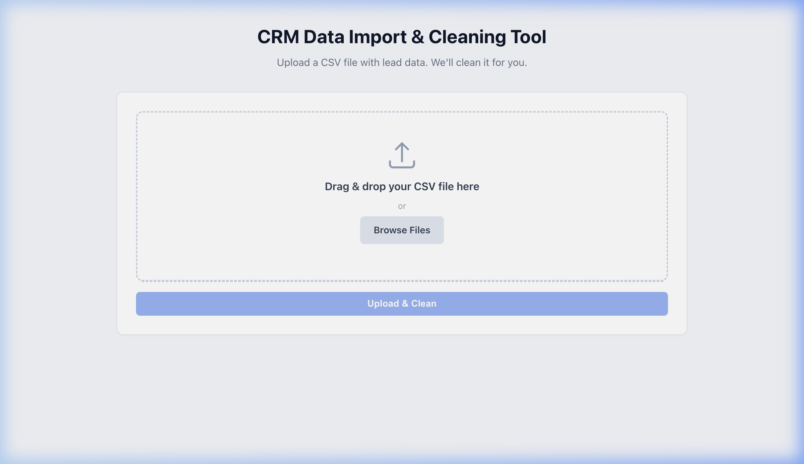

# CRM Data Import and Cleaning Tool

I kept running into the same problem at work -- our sales team would hand me CRM export files full of duplicate contacts, inconsistent formatting, and broken email addresses. Cleaning them manually in Excel took forever. So I built this tool to handle it automatically. Upload a messy CSV, get a clean one back in seconds.



## Features

- CSV file upload with drag-and-drop support
- Trims whitespace from all fields and column headers
- Normalizes name and company capitalization to Title Case
- Validates email format and flags invalid addresses
- Normalizes phone numbers to international format (converts Nigerian local numbers starting with 0 to +234)
- Detects and removes duplicate rows based on email address
- Flags rows missing required fields (Name or Email)
- Displays a cleaning summary (total rows, duplicates removed, invalid emails, missing fields)
- Previews cleaned data in a table before downloading
- One-click download of the cleaned CSV file
- File type validation (CSV only, 10MB max)
- Server-side error handling for malformed files

## Tech Stack

- **Runtime:** Node.js
- **Server:** Express
- **File Upload:** Multer (in-memory storage)
- **CSV Parsing:** PapaParse
- **Frontend:** Vanilla HTML, CSS, JavaScript (no frameworks)

## How to Run Locally

```bash
git clone https://github.com/btcbarbie/crm-data-import-cleaning-tool.git
cd crm-data-import-cleaning-tool
npm install
npm start
```

The server starts on **port 3000** by default. Open [http://localhost:3000](http://localhost:3000) in your browser.

To use a different port, set the `PORT` environment variable:

```bash
PORT=8080 npm start
```

## Project Structure

```
crm-data-import-cleaning-tool/
  server.js           # Express server and cleaning logic
  package.json
  public/
    index.html        # Frontend UI
    style.css         # Styles
```

## How It Works

1. User uploads a CSV file with columns: Name, Email, Phone, Company
2. The server parses the CSV, runs the cleaning pipeline, and returns the results as JSON
3. The frontend renders the cleaned data in a table with a summary of what was fixed
4. User downloads the cleaned CSV

## Expected CSV Format

```csv
Name,Email,Phone,Company
John Doe,john@example.com,08012345678,Acme Corp
```

The tool expects these column headers: **Name**, **Email**, **Phone**, **Company**. Rows with missing Name or Email are flagged but still included in the output.

## License

MIT
